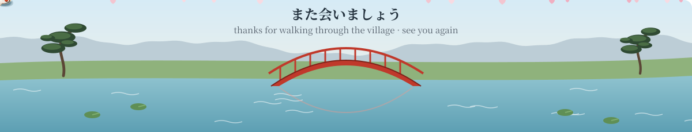

<!-- generated by build.py — edit the DATA section there and re-run -->

AI Engineer with a background in **low-power and low-bit inference**: squeezing models onto whatever silicon is in front of me, optimised for latency or power, from **GB200 racks** down to **low-power embedded boards**.

I also build the layer between raw data and the AI that reasons over it: **entity resolution, knowledge graphs, RAG and MCP tooling**, plus the pipelines, CI/CD and infrastructure to run them in production. I'm comfortable sitting with domain experts and turning their knowledge into explicit, testable definitions.

I care about the parts most people skip: **profiling, kernels, portability across heterogeneous back-ends, and reproducibility.**

- 🏯 **Now:** AI Performance Engineer at [ZAL Analytics](https://www.zal-analytics.ch) — air-gapped AI & data intelligence
- 🔩 **Also:** building with [Compressor Systems Holland](https://github.com/Compressor-Systems-Holland-B-V)
- 🌍 Dutch citizen · 5+ years across NL, CH, FR, BE and NO
- 🗣️ English · Dutch · French · German
- 🎓 MSc Data Science · BSc Technical Informatics

<table>
<tr>
<td width="50%" valign="top" align="center">
<h4>言語 &nbsp;·&nbsp; Languages</h4>

  
</td>
<td width="50%" valign="top" align="center">
<h4>推論 &nbsp;·&nbsp; GPU · Inference</h4>

  
</td>
</tr>
<tr>
<td width="50%" valign="top" align="center">
<h4>知識 &nbsp;·&nbsp; AI · Knowledge</h4>

  
</td>
<td width="50%" valign="top" align="center">
<h4>基盤 &nbsp;·&nbsp; Infra · Tools</h4>

  
</td>
</tr>
</table>

